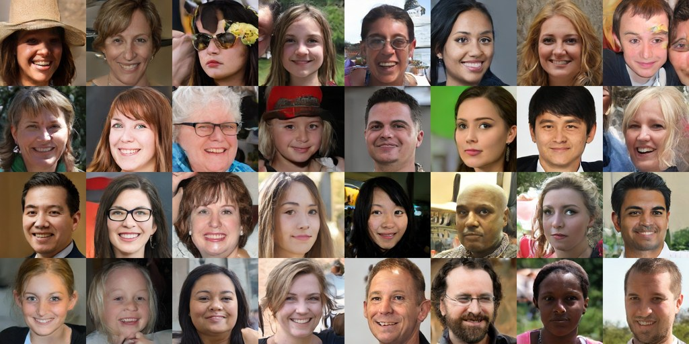
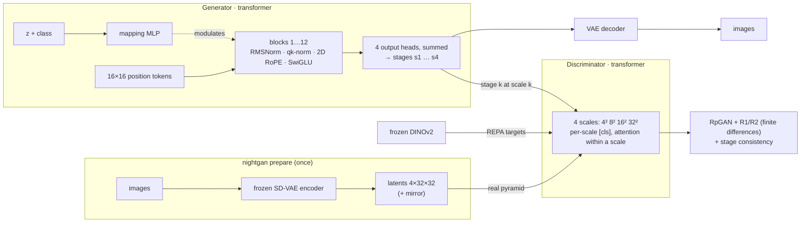

<div align="center">

# 🌙 nightgan

**A modern GAN you can train overnight on one consumer GPU.**

Transformer generator and discriminator in the latent space of a frozen VAE, assembled from the strongest GAN
research of 2024&ndash;2026. Pure PyTorch, `pip install`, three commands.

[](https://github.com/AlexMelanFromRingo/nightgan/actions/workflows/tests.yml)


[](LICENSE)



<sub>FFHQ 256&times;256 after <b>one night (10 hours)</b> on one RTX 4080 SUPER &mdash; preset S, FID-10k 11.2 (FID-50k 9.9), no
truncation, no cherry-picking. At equal time (3 h, same card): nightgan 23.0, StyleGAN2-ADA 61.3, lightweight-gan 82.5,
R3GAN 278.9.</sub>

[Quick start](#-quick-start) &bull; [How it works](#-how-it-works) &bull; [Results](docs/results.md) &bull;
[Options](#%EF%B8%8F-training-options) &bull; [Python API](#-python-api) &bull; [Troubleshooting](#-troubleshooting)

</div>

---

## ✨ Highlights

| | |
|---|---|
| ⚡ **Fast** | 143 images/s on an RTX 4080 SUPER (preset S, 7 GB): **5 M images in a night**, ~5x StyleGAN2-ADA on the same card |
| 🧠 **State of the art recipe** | [GAT](https://arxiv.org/abs/2509.24935) (ICML 2026) + [CAT](https://arxiv.org/abs/2605.26449) (2026) + [R3GAN](https://arxiv.org/abs/2501.05441) loss + [REPA](https://arxiv.org/abs/2410.06940) with DINOv2 |
| 📦 **No dependency hell** | no custom CUDA kernels, no Docker, no compiler: `pip install -e .` |
| 🛟 **Hard to break** | resumes exactly where it stopped, restarts itself after a GPU reset, skips non-finite steps, picks the batch that fits your GPU |
| 🎯 **Complete** | dataset preparation, training with live FID / KID, generation, interpolation videos, evaluation, a small `.safetensors` model |
| 🏷️ **Conditional** | one subfolder per class &rarr; `--class` at generation time; 128, 256 and 512 px |

## 🚀 Quick start

```bash
git clone https://github.com/AlexMelanFromRingo/nightgan && cd nightgan
pip install -e .          # PyTorch with CUDA first if your platform's default wheel has none; [video] for .mp4
```

```bash
# 1. encode a folder of images once (searched recursively: jpg, png, webp, ...)
nightgan prepare ~/my_images data/mine --resolution 256      # --labels dirs: subfolders are classes

# 2. train; the same command again resumes
nightgan train data/mine runs/mine --preset S --time 10h

# 3. use the model
nightgan generate    runs/mine out/ --seeds 0-63 --grid
nightgan interpolate runs/mine walk.gif --seeds 1,7,42 --frames 60
nightgan eval        runs/mine data/mine --metrics fid,kid,fd_dinov2
```

The run folder fills up with `samples/` (a grid of fixed seeds every 100k images), `log.jsonl` (losses, speed,
FID), `checkpoints/` (every 15 minutes), `model.safetensors` (latest generator) and `model-best.safetensors`.
The first run downloads the Stable Diffusion VAE, DINOv2 ViT-B/14 and the FID Inception network (~800 MB in total);
afterwards everything works offline.

## 🧩 How it works



- **Latent space.** A 256 px image is a 4&times;32&times;32 latent of the Stable Diffusion VAE: the networks see 16&times;16
  tokens instead of 65 536 pixels, and no image is decoded during training.
- **Generator** (GAT): the latent `z` enters only through a mapping network that modulates every transformer block;
  four output heads add up to the image, and their partial sums are four *stages*.
- **Discriminator** (CAT): judges stage *k* at resolution 1/2<sup>3&minus;k</sup>, with a [cls] token per scale and
  block-diagonal attention; a projection head for classes.
- **Loss** (R3GAN): relativistic pairing loss with zero-centered R1 and R2 penalties, estimated by finite
  differences, so fused attention works and no double backpropagation is needed.
- **Stage consistency** (CAT) keeps the intermediate stages close to the final output; **REPA** aligns the
  discriminator's features with DINOv2, which helps most on small datasets; **DiffAugment** in latent space.

Details, design decisions and the pitfalls found on the way: [docs/how-it-works.md](docs/how-it-works.md).

## 📊 Presets and speed

Measured on an RTX 4080 SUPER (16 GB, WSL2), batch 256, bf16, `torch.compile`, with REPA:

| Preset | Generator / discriminator | Images / s | GPU memory | Images in 10 h |
|:---:|:---:|:---:|:---:|:---:|
| **S** | 29M / 37M | 143 | 7.2 GB | ~5.1 M |
| **B** | 117M / 102M | 58 | 9.7 GB | ~2.1 M |

128, 256 and 512 px run at the same speed (16&times;16 tokens: latent patch 1, 2, 4). Without REPA
(`--repa-weight 0`) training is ~12 % faster. Results and the equal-time comparison with StyleGAN2-ADA, R3GAN and
lightweight-gan: [docs/results.md](docs/results.md).

## ⚙️ Training options

<details>
<summary><b>All options of <code>nightgan train</code></b></summary>

| Option | Default | Meaning |
|---|---|---|
| `--preset` | `S` | model size; `--dim --depth --heads --d-dim --d-depth --d-heads --z-dim --patch` override it |
| `--time` / `--kimg` | until stopped | training length (`10h`, `90m`, `2d`; whole sessions, evaluations included) or thousands of images; the learning rate decays over the last third; a resumed run keeps its length |
| `--batch` | 256 | images per optimizer step |
| `--micro-batch` | 0 (auto) | images per forward pass: the largest that fits ~85 % of the free GPU memory, the rest is gradient accumulation |
| `--lr-g`, `--lr-d` | `2e-4 · 768 / width` | learning rates (width-aware, from GAT) |
| `--optimizer`, `--beta1`, `--beta2` | `adamw`, 0, 0.99 | AdamW as in the GAT / R3GAN recipes, or `adabelief` (needs momentum: beta1 0.5 by default) |
| `--gamma` | 0.1 | weight of the R1 + R2 penalties |
| `--gp-sigma` | 0.03 | noise of the finite-difference penalty (bf16-safe) |
| `--cons-weight` | 0.1 | stage consistency |
| `--repa-weight`, `--repa-encoder` | 1, `dinov2_vitb14` | representation alignment; `--repa-weight 0` disables it |
| `--aug-policy`, `--aug-p` | `color,translation,cutout`, 1 | latent DiffAugment |
| `--ema-halflife-kimg` | 350 | half-life of the generator average, in thousands of images |
| `--eval-every-kimg`, `--eval-num` | 500, 10000 | FID / KID during training (0 disables) |
| `--sample-every-kimg`, `--snapshot-minutes` | 100, 15 | sample grids and snapshots |
| `--no-compile`, `--checkpointing` | | eager mode (Windows without triton) / gradient checkpointing |
| `--force-config` | | start over in a run folder with a different model (old snapshots are moved aside) |

`nightgan <command> --help` lists everything.
</details>

<details>
<summary><b>Datasets</b></summary>

`nightgan prepare` center-crops every image to a square, resizes it (Lanczos), applies the EXIF rotation, puts
transparent images on white, converts palette / grayscale / CMYK / 16-bit images, skips unreadable files, hidden
files and `__MACOSX` (listed at the end), checks the free disk space first, and encodes each image together with its
mirror image. About 180 KB per image plus up to ~170 MB of FID / FD-DINOv2 reference statistics.

At the end it measures the **autoencoder ceiling**: 10 000 dataset images decoded from their latents, scored like a
model (`autoencoder ceiling: FID 2.35, KID 0.53e-3 ...` on FFHQ). No model trained on these latents can do better in
an evaluation of as many images; if the number is high for your images (fine text, line art, unusual domains), try
another `--autoencoder` or `--autoencoder pixel` for small images. `--recon-num 0` skips it (it takes a few minutes at 256 px);
`nightgan eval data/mine --reconstruction [--num 5000]` measures it again, e.g. with as many images as your
evaluations.

Small datasets (a few hundred to a few thousand images) work thanks to augmentation and REPA; 10k+ images give the
best results. Hugging Face parquet datasets: `python tools/parquet_to_images.py <parquet dir> <folder> [--label-column label]`.
</details>

## 🐍 Python API

```python
import nightgan

pipe = nightgan.load("runs/mine")                         # or a model.safetensors file
images = pipe.generate(seeds=range(8), truncation=0.8)   # list of PIL images
frames = pipe.interpolate([1, 7, 42], frames=30)          # a looping latent walk
pipe.generate(n=4, class_idx=2)                           # class-conditional models
```

## 🛠 Troubleshooting

<details>
<summary><b>Training is several times slower than the table on Windows / WSL2</b></summary>

The GPU memory is full and the driver moves memory to the system RAM instead of failing. Close other GPU programs or
lower `--micro-batch`; the automatic choice leaves 15 % of the free memory unused.
</details>

<details>
<summary><b>"GPU error … restarting from the last snapshot"</b></summary>

The driver reset the GPU (on Windows / WSL2 e.g. after a timeout, or because another program crashed it). Training
restarts itself from the last snapshot, up to 5 times in a row. Avoid running other CUDA programs on the same GPU
during long runs.
</details>

<details>
<summary><b>"non-finite loss … step skipped"</b></summary>

A single skipped step is harmless; three in a row stop the run after writing a snapshot. Lower `--lr-g` / `--lr-d`
or raise `--gamma`, then run the same command to resume.
</details>

<details>
<summary><b>Windows without triton</b></summary>

`torch.compile` needs triton; use `--no-compile` (~20 % slower). WSL2 is the faster way to run nightgan on Windows.
</details>

## 🧪 Tests

```bash
pip install -e ".[dev]" && pytest      # offline, CPU, ~2 min
pytest -m slow                         # with the pretrained networks (downloads them)
```

## 📚 Credits

nightgan is [MIT licensed](LICENSE); the code is written from the papers. It builds on:

- **GAT** &mdash; Hyun, Lee, Heo. *Scalable GANs with Transformers.* ICML 2026. [arXiv:2509.24935](https://arxiv.org/abs/2509.24935)
- **CAT** &mdash; *Cross-scale Aligned Supervision for Training GANs.* 2026. [arXiv:2605.26449](https://arxiv.org/abs/2605.26449)
- **R3GAN** &mdash; Huang, Gokaslan, Kuleshov, Tompkin. *The GAN is dead; long live the GAN!* NeurIPS 2024. [arXiv:2501.05441](https://arxiv.org/abs/2501.05441)
- **REPA** &mdash; Yu et al. *Representation Alignment for Generation.* ICLR 2025. [arXiv:2410.06940](https://arxiv.org/abs/2410.06940)
- **DiffAugment** &mdash; Zhao et al. NeurIPS 2020. [arXiv:2006.10738](https://arxiv.org/abs/2006.10738)

Pretrained networks used: Stable Diffusion VAE `stabilityai/sd-vae-ft-mse` (MIT), DINOv2 (Apache-2.0), the FID
InceptionV3 of pytorch-fid (Apache-2.0).
