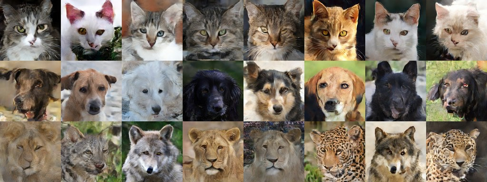
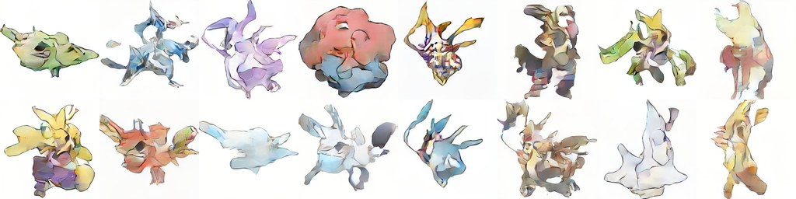
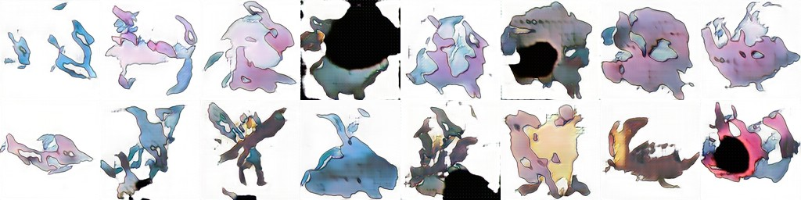

# Results

Work in progress: the table is updated as the runs finish. Nothing here is extrapolated: a number is
either measured or marked *pending*.

All numbers: RTX 4080 SUPER (16 GB), WSL2, PyTorch 2.14 + CUDA 13.0. FID / KID are computed by `nightgan eval` /
the in-training evaluation (InceptionV3 of the original TensorFlow FID, 10 000 generated images against the statistics
of all 70 000 dataset images, EMA generator, no truncation). FID-10k is higher than the usual FID-50k for the same model.

## FFHQ 256 x 256, preset S

`nightgan train data/ffhq256 runs/ffhq --preset S --time 10h` — 29M-parameter generator, 37M discriminator, batch 256,
143 img/s (median after warm-up), 7.2 GB of GPU memory. The run went to 3 h, was evaluated, then continued to 10 h
(the continuation restarts the learning-rate schedule for a 10 h run).

| Training time | Images seen | FID-10k | KID-10k (x1e-3) |
|---|---|---|---|
| 1.15 h | 0.50 M | 47.88 | 29.28 |
| 2.18 h | 1.00 M | 27.85 | 13.32 |
| 3.00 h | 1.42 M | 22.54 | 10.43 |
| 4.75 h | 2.00 M | 16.25 | 6.26 |
| 7.00 h | 3.00 M | 14.09 | 5.93 |
| 9.05 h | 4.00 M | 12.03 | 4.98 |
| **10.00 h** | **4.49 M** | **11.18** | **4.63** |

`nightgan eval` of the final model (other seeds than the in-training evaluation): FID-10k 11.20, KID 4.63e-3,
FD-DINOv2 298.6. The repeated evaluations of the same model differ by up to ~0.5 FID (sampling of the 10k images).

**FID-50k** (the usual protocol: 50 000 generated images against all 70 000, `nightgan eval MODEL DATA`): **9.88**
after 10 h (KID 4.73e-3), 21.35 after 3 h (KID 10.66e-3).

After 10 hours (training grid seeds, no truncation, no cherry-picking):

After 3 hours:

## Equal-time comparison (3 h each, same GPU, same data)

Speed is training throughput after warm-up; quality is the last snapshot before the budget ends, all evaluated by
`nightgan eval` on 10k images (the same reference statistics, Inception and DINOv2 networks).

| Model | Throughput | Images in the budget | FID-10k | KID-10k (x1e-3) | FD-DINOv2 |
|---|---|---|---|---|---|
| **nightgan S** | 143 img/s | 1.42 M in 3 h | **22.98** | **10.8** | **574** |
| StyleGAN2-ADA (`--cfg=stylegan2`, batch 32, gamma 1, CUDA kernels) | 26 img/s | 0.27 M in 3 h 03 min | 61.30 | 43.7 | 1356 |
| lightweight-gan 1.3.0 (defaults, batch 10 x 4) | 43–60 img/s | 0.60 M in 3 h 04 min | 82.49 | 75.8 | 1338 |
| R3GAN (FFHQ-256 preset, batch 64, its bf16 CUDA kernels) | 3.7 img/s | 0.04 M in 3 h 01 min | 278.92 | 317.7 | 2439 |

nightgan reaches in 1 hour (FID-10k 47.9) a better FID than any of the baselines in 3 hours. FID-10k over time for
nightgan and StyleGAN2-ADA, the best baseline (its snapshots scored the same way):

| | ~1 h | ~2 h | ~3 h |
|---|---|---|---|
| **nightgan S** | **47.88** (1.15 h) | **27.85** (2.18 h) | **22.98** (3.00 h) |
| StyleGAN2-ADA | 167.57 (0.99 h) | 89.23 (2.02 h) | 61.30 (3.05 h) |

StyleGAN2-ADA at 2.66 h: 74.97. nightgan at 1 h and 2 h: the evaluation during training (same code and reference,
other seeds).

On one 16 GB card the pixel-space GANs see 5x (StyleGAN2-ADA) to 40x (R3GAN) fewer images in the same time. R3GAN's
FFHQ-256 configuration was trained on 8 GPUs with batch 256 in the paper; at 3.7 img/s it would need about 60 days on
this card to see the 20 M images of its schedule.

Notes on the runs:

- StyleGAN2-ADA was interrupted by a power cut after 2 h 38 min and resumed from its last snapshot (`--resume`) for
  25 minutes; the resume resets the Adam moments (the ADA probability was still 0). Disk-heavy cleanup during the
  resumed part slowed its data loading for a few minutes, so it got 2 extra minutes.
- R3GAN died after 1 h 32 min with `CUDA error: unknown error` and lightweight-gan was paused after 1 h 23 min;
  both were continued from their snapshots to 3 h. lightweight-gan ran at 43 img/s before the pause (right after the
  GPU fault) and at 60 img/s after it; R3GAN's continuation restarts its Adam moments.
- lightweight-gan writes its samples as JPEG (quality 75); scored that way it gets FID 94.55, KID 93.3e-3,
  FD-DINOv2 1369. The table uses lossless PNG samples of the same model ([tools/lwgan_png.py](../tools/lwgan_png.py)),
  like the other models.
- The exact commands and the patches the baselines needed for current PyTorch are in
  [tools/baselines.sh](../tools/baselines.sh).

## AFHQ-v2 256 x 256 with classes, preset S

15 803 images in 3 classes (cat, dog, wild), `nightgan prepare --labels dirs`, then
`nightgan train data/afhq runs/afhq --preset S --time 2h` (the class becomes an input of the mapping network and a
projection head of the discriminator). 138–145 img/s.

| Training time | Images seen | FID-10k | KID-10k (x1e-3) |
|---|---|---|---|
| 1.1 h | 0.50 M | 37.95 | 18.71 |
| 2.0 h | 0.87 M | 22.33 | 10.32 |

Rows: cat, dog, wild (the class given to the generator), no truncation, no cherry-picking:

## Pokemon (833 images), preset S — a weak spot

`nightgan train data/pokemon runs/pokemon --preset S --time 1.5h`, FID / KID on 5 000 generated images against the 833
dataset images (FID is strongly biased with so few reference images; KID is the more meaningful number here).

| Training time | Images seen | FID-5k | KID (x1e-3) |
|---|---|---|---|
| 0.5 h | 0.20 M | 141.7 | 121.5 |
| 1.0 h | 0.40 M | 126.4 | 103.9 |
| 1.5 h | 0.58 M | 117.4 | 94.0 |

The samples have the colors, outlines and white backgrounds of the dataset and do not collapse, but they are not yet
coherent creatures:

On a dataset this small nightgan does not yet do what it does on FFHQ / AFHQ. For comparison, lightweight-gan
(FastGAN, made for few-shot data) on the same 833 images for the same 1.5 h (defaults, batch 10 x 4, bf16, 62 img/s),
scored the same way (5 000 PNG samples of its EMA generator):

| Model, 1.5 h | Images seen | FID-5k | KID (x1e-3) |
|---|---|---|---|
| **nightgan S** | 0.58 M | **117.4** | **94.0** |
| lightweight-gan 1.3.0 | 0.36 M | 135.6 | 109.3 |

lightweight-gan is not more coherent here either (first 16 of the scored samples):

Both need more than 1.5 h for 833 images; few-shot data remains the weakest case for nightgan.

## Ablations (FFHQ 256, preset S, FID-10k at 500 kimg)

Each run follows the schedule of the main run (`--time 3h`) and is stopped after its evaluation at 500 kimg (~1 h).
One seed per variant, except the default configuration, which was run with two seeds.

| Variant | FID-10k at 500 kimg | KID-10k (x1e-3) |
|---|---|---|
| default, seed 0 (the main run) | 47.88 | 29.28 |
| default, seed 1 | 58.88 | 42.29 |
| AdaBelief, beta1 0.5 | 58.31 | 40.41 |
| no stage consistency (`--cons-weight 0`) | 48.01 | 30.95 |
| no REPA (`--repa-weight 0`) | 65.26 | 45.77 |
| no DiffAugment (`--aug-p 0`) | 74.32 | 60.22 |

The two seeds of the default configuration differ by 11 FID at this point, so only large differences mean something:

- **DiffAugment matters** even with 70k images: without it FID is far worse than either seed.
- **REPA likely helps**: without it FID is worse than both seeds; more seeds are needed to be sure.
- **AdaBelief** and **removing the stage consistency** stay within the seed spread at 1 h: no measurable effect. CAT
  reports the gain of the consistency loss for longer runs and larger models.

## Planned

- More seeds per ablation (the spread between seeds is ~11 FID at 1 h).
- Longer runs on small datasets (Pokemon after 1.5 h is not yet coherent with either GAN).

## Found along the way

- **Stage consistency must not use a stop-gradient** on the final output (the generator stages are partial sums):
  with it, a first run collapsed to one texture within 120 steps (generator output RMS 90 instead of 1).
- **GPU synchronizations cost 35 % of the speed** on real data: data-dependent branches in the augmentation, indexing
  with a Python list in the discriminator, `bincount` in the class average, and memory-mapped reads of the REPA images
  in the main thread. Fixed: 88 → 143 img/s on FFHQ, the same as on synthetic data.
- **GPU faults under WSL2.** Three runs (two nightgan, one R3GAN) died with `CUDA error: unknown error`; two of them
  while another CUDA process ran on the same GPU. Windows logged no hardware (WHEA) or driver (Xid, TDR) error at
  those times. nightgan now restarts itself from the last snapshot (every 15 minutes); the baselines were continued
  from their snapshots.
- **Lossy samples bias FID.** lightweight-gan saves generated images as JPEG (quality 75): the same model scores
  FID-10k 94.55 from its JPEG files and 82.49 from PNG files. Compare models only on lossless samples.
- **Stale pip CUDA toolkit links.** The StyleGAN3 / R3GAN kernel loader cached a `CUDA_HOME` of symlinks into a Python
  environment; after that environment was deleted, every kernel build failed. Fixed in the
  [modernized StyleGAN3 fork](https://github.com/AlexMelanFromRingo/stylegan3) (one `CUDA_HOME` per environment).
