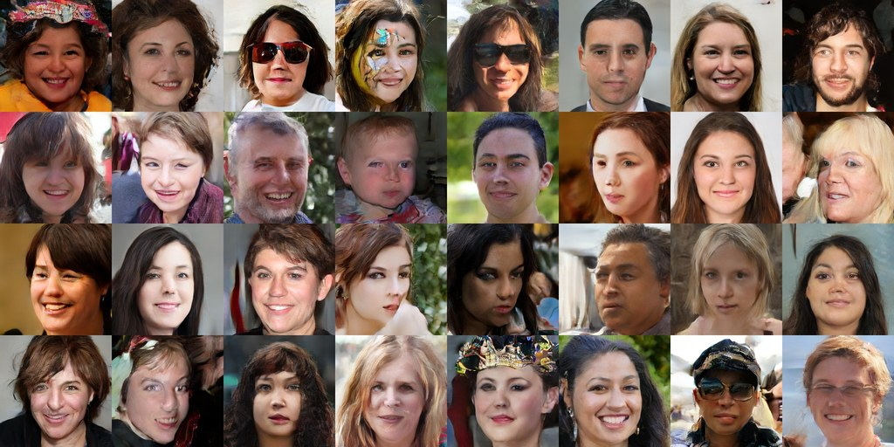

# Results

Work in progress: the equal-time comparison with the baselines is running. This page is updated as runs finish.

All numbers: RTX 4080 SUPER (16 GB), WSL2, PyTorch 2.14 + CUDA 13.0. FID / KID are computed by `nightgan eval` /
the in-training evaluation (InceptionV3 of the original TensorFlow FID, 10 000 generated images against the statistics
of all 70 000 dataset images, EMA generator, no truncation). FID-10k is higher than the usual FID-50k for the same model.

## FFHQ 256 x 256, preset S

`nightgan train data/ffhq256 runs/ffhq --preset S --time 3h` — 29M-parameter generator, 37M discriminator, batch 256,
143 img/s (median after warm-up), 7.2 GB of GPU memory.

| Training time | Images seen | FID-10k | KID-10k (x1e-3) |
|---|---|---|---|
| 1.15 h | 0.50 M | 47.88 | 29.28 |
| 2.18 h | 1.00 M | 27.85 | 13.32 |
| 3.00 h | 1.42 M | 22.54 | 10.43 |

Samples after 3 hours (seeds of the training grid, no truncation, no cherry-picking):

## Equal-time comparison (3 h each, same GPU)

| Model | Images in 3 h | FID-10k | KID-10k | FD-DINOv2 |
|---|---|---|---|---|
| nightgan S | 1.42 M | 22.54 | 10.43e-3 | running |
| StyleGAN2-ADA (`--cfg=stylegan2`, modernized StyleGAN3 code with its CUDA kernels) | ~0.28 M (38.5 s / kimg) | running | | |
| R3GAN (FFHQ-256 preset, batch 64) | | queued | | |
| lightweight-gan 1.3.0 | | queued | | |

The exact commands are in [tools/baselines.sh](../tools/baselines.sh).

## Found along the way

- **Stage consistency must not use a stop-gradient** on the final output (the generator stages are partial sums):
  with it, a first run collapsed to one texture within 120 steps (generator output RMS 90 instead of 1).
- **GPU synchronizations cost 35 % of the speed** on real data: data-dependent branches in the augmentation, indexing
  with a Python list in the discriminator, `bincount` in the class average, and memory-mapped reads of the REPA images
  in the main thread. Fixed: 88 → 143 img/s on FFHQ, the same as on synthetic data.
- **WSL2 / GPU resets:** two runs died with `CUDA_ERROR_UNKNOWN` while another process used the same GPU; training now
  restarts itself from the last snapshot (every 15 minutes).
